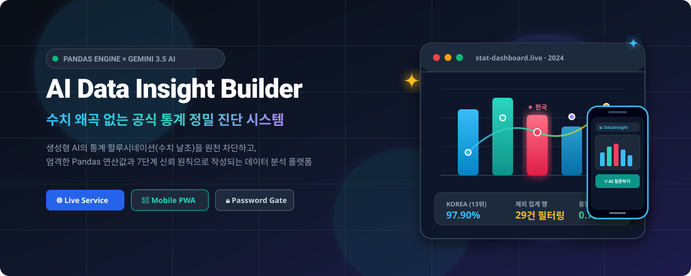
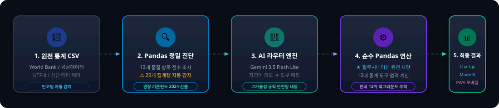
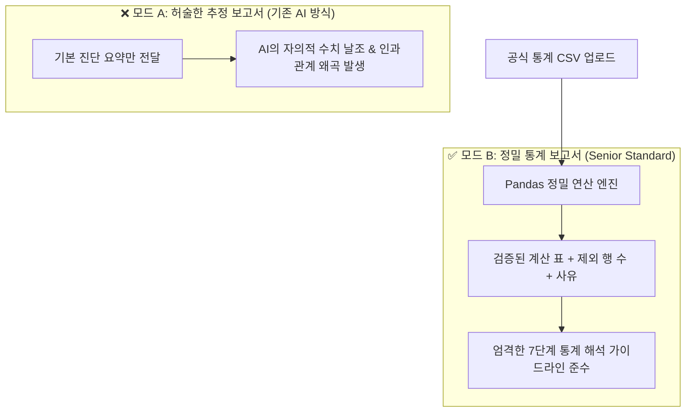

<div align="center">



# 📊 AI Data Insight Builder
### 공식 통계 데이터 정밀 진단 × Pandas 계산 기반 AI 해석 시스템
**Empirical Statistical Analysis Engine powered by Google Gemini 3.5 & Progressive Web App**

<br />

[](https://data-insight-builder-one.vercel.app/)
[](https://python.org)
[](https://flask.palletsprojects.com/)
[](https://pandas.pydata.org/)
[](https://ai.google.dev/)
[](https://data-insight-builder-one.vercel.app/)

<br />

**[ 🌐 라이브 서비스 체험하기 ](https://data-insight-builder-one.vercel.app/)** &nbsp;•&nbsp; **[ 📱 PWA 앱 다운로드 ](#-모바일-pwa-앱-설치-가이드)** &nbsp;•&nbsp; **[ 🔬 12대 통계 엔진 ](#-12대-정밀-통계-분석-도구-카탈로그)**

<br />

<!-- 눈에 띄는 비밀번호 안내 배너 -->
<div align="center">
  <table style="border: 2px solid #3b82f6; background-color: #eff6ff; border-radius: 12px; margin: 10px 0;">
    <tr>
      <td align="center" style="padding: 14px 28px;">
        <span style="font-size: 1.2rem; font-weight: 800; color: #1e3a8a;">
          🔑 웹 접속 비밀번호: <mark style="background: #1e3a8a; color: #ffffff; padding: 4px 12px; border-radius: 6px; font-weight: 800; font-size: 1.25rem;">1234</mark>
        </span>
        <br />
        <span style="font-size: 0.88rem; color: #475569; display: inline-block; margin-top: 4px;">
          외부 무단 접근 및 Gemini API 과금 방지를 위한 Password Gate가 적용되어 있습니다. 접속 후 <b>1234</b>를 입력해 주세요.
        </span>
      </td>
    </tr>
  </table>
</div>

</div>

<br />

---

## ⚡ 5단계 엔드투엔드 데이터 파이프라인

기존 AI 서비스처럼 원본 데이터를 그대로 LLM에 던지지 않습니다. **13대 항목 사전 진단과 순수 Pandas 수치 계산**을 거쳐 통계적 진실만을 보고서로 승화시킵니다.

<div align="center">
  
</div>

<br />

---

## 🎯 4대 핵심 아키텍처 원칙 (Why AI Data Insight Builder?)

<table>
  <tr>
    <td width="50%" valign="top">
      <h3>🚫 1. 수치 왜곡 제로 (No Hallucination)</h3>
      <p>생성형 AI에게 절대 숫자를 직접 계산시키지 않습니다. 모든 평균, 백분율, 순위, 사분위수는 <b>오직 Pandas 엔진만이 정밀 연산</b>하며 AI는 검증된 표(Table)만을 해석합니다.</p>
    </td>
    <td width="50%" valign="top">
      <h3>🔍 2. 13개 품질 항목 전수 진단</h3>
      <p>World Bank, 공공데이터 등 공식 통계의 고질적 왜곡 요인인 <b>상단 메타 헤더(4줄 스킵), 인코딩 불일치, 결측치, 29개 집계 행(World, OECD 등)</b>을 업로드 즉시 감지하여 통계 왜곡을 사전 차단합니다.</p>
    </td>
  </tr>
  <tr>
    <td width="50%" valign="top">
      <h3>💬 3. 지능형 자연어 라우터 & 안전망</h3>
      <p><i>"2024 상위 10개국이랑 한국 비교해줘"</i> 같은 자연어 요청 시, Gemini AI가 최적 도구를 매핑하고 <b>순위 밖 국가(대한민국 13위, 97.90%)를 실시간 역추적하여 차트와 표에 하이라이트</b>합니다. (외부 AI 지연 시 룰 기반 안전망 100% 가동)</p>
    </td>
    <td width="50%" valign="top">
      <h3>📱 4. PWA 모바일 앱 & Vercel 무중단 복원</h3>
      <p>스마트폰에서 주소창 없는 <b>네이티브 앱으로 1초 설치(PWA)</b>를 지원합니다. Vercel 서버리스 특성으로 인스턴스가 꺼지더라도 클라이언트-서버 간 데이터 동기화로 <b>업로드한 데이터가 절대 유실되지 않습니다.</b></p>
    </td>
  </tr>
</table>

<br />

---

## 🎨 맞춤형 데이터 분석 및 시각화 (자연어 ➔ 즉시 차트 & 표 생성)

사용자가 복잡한 X축, Y축, 집계 함수를 일일이 지정할 필요가 없습니다. **일상적인 자연어로 원하는 분석을 입력하면, AI 라우터가 의도를 해석하여 12대 통계 도구 중 최적의 도구와 파라미터를 자동 매핑하고 Pandas가 0.7초 만에 차트와 표를 동시에 생성**합니다.

```
[사용자 자연어 입력]
"2024 인터넷 상위 10개국이랑 한국 비교하면서 표로도 만들어줘"
        │
        ▼
[Gemini 3.5 지능형 라우터] ──(503 지연 시 규칙 안전망 자동 가동)──┐
  • 선택 도구 : top_bottom_n                                      │
  • 기준 연도 : 2024 (권장 기준연도 자동 적용)                      │
  • 비교 대상 : include_items: ["Korea, Rep."]                     ▼
        │                                                [Pandas 초고속 연산]
        ▼                                                • 상위 10개국 순위 추출
[인터랙티브 시각화 & 표 생성]                              • 한국 13위 (97.90%) 역추적
  • Chart.js : 상위 10개국 막대 + 붉은색 강조 막대(★ Korea 13위)
  • Table    : 전체 순위 표 + 노란색 하이라이트 비교 행(비교 대상 전체 13위)
  • Summary  : "2024년 기준 1위는 UAE(100.00)이며, 비교 대상인 Korea는 전체 13위(97.90)입니다."
```

### 💡 대표적인 맞춤형 분석 명령어 예시

| 사용 목적 | 자연어 프롬프트 예시 | 자동 매핑 도구 & 결과 |
| :--- | :--- | :--- |
| **특정 국가 비교 순위** | *"2024 인터넷 상위 10개국이랑 한국 비교하면서 표로도 만들어줘"* | `top_bottom_n` ➔ 상위 10개국 + **13위 한국 붉은색 막대 & 노란색 표 하이라이트** |
| **구간별 빈도 분포** | *"2024년 인터넷보급률 히스토그램 그려줘"* | `distribution` ➔ 수치 구간별 국가 수 빈도수 히스토그램 막대 차트 |
| **장기 시계열 추이** | *"한국과 주요 국가들의 연도별 시계열 추이선 보여줘"* | `trend_line` ➔ 다중 국가의 연도별 꺾은선 추세선 차트 |
| **전체 집단 vs 내 위치** | *"우리나라 인터넷 보급률은 전 세계 평균과 비교해서 어때?"* | `compare_one_vs_all` ➔ 개별 국가 vs 전체 평균/중앙값 비교 차트 |
| **성장률 및 변화량** | *"2015년부터 2024년까지 가장 인터넷이 많이 증가한 나라"* | `change_rate` ➔ 절대 증가량 및 상대 성장률(%) 분석 차트 |

> 🛡️ **외부 AI 트래픽 과부하(503) 대비 고가용성 규칙 안전망 (Fallback Rule Engine)**  
> 외부 Gemini API 서버가 일시적인 지연(503 Spike)을 겪더라도, 백엔드에 내장된 정규표현식 규칙 엔진(`fallback_rule_mapper`)이 즉시 가동되어 사용자는 **대기시간이나 에러 없이 100% 정상적으로 그래프를 도출**받을 수 있습니다.

<br />

---

## 🔬 12대 정밀 통계 분석 도구 카탈로그

Pandas 라이브러리를 통해 수학적·통계적으로 검증된 12가지 정밀 분석 도구가 탑재되어 있습니다:

```
┌── 구조 및 품질 감사 ──────┬── 단변량 및 분포 분석 ─────┬── 시계열 및 비교 분석 ─────┐
│ 01. reshape_wide_to_long │ 05. describe_numeric      │ 06. trend_line (시계열)   │
│ 02. quality_report       │ 07. top_bottom_n (순위)   │ 09. change_rate (성장률)  │
│ 03. year_coverage (충실도)│ 10. distribution (히스토) │ 11. compare_one_vs_all   │
│ 04. detect_aggregates    │ 08. group_summary (그룹)  │ 12. correlation_scatter  │
└──────────────────────────┴───────────────────────────┴──────────────────────────┘
```

<details>
<summary><b>🔍 12대 도구별 세부 통계 명세표 펼쳐보기 (Click)</b></summary>
<br />

| 도구명 | 분석 기법 | 시각화 형태 | 핵심 역할 및 통계적 의의 |
| :--- | :--- | :---: | :--- |
| **`reshape_wide_to_long`** | 데이터 구조 재형태화 | - | 가로로 나열된 연도 열들을 세로(Long) 행으로 접어 패널 데이터 포맷으로 표준화 |
| **`quality_report`** | 데이터 무결성 감사 | - | 결측률, 중복 행, 열별 타입 및 구조적 무결성 점검 보고서 생성 |
| **`year_coverage`** | 연도별 충실도 분석 | Bar Chart | 결측치가 가장 적고 신뢰도가 높은 **최적 권장 기준연도(2024년) 자동 도출** |
| **`detect_aggregates`** | 왜곡 요인(집계 행) 감지 | Table | World, OECD, 소득 그룹 등 국가 간 통계 왜곡을 일으키는 29개 이상 집계 행 식별 |
| **`describe_numeric`** | 기초 기술통계량 | Table | 평균, 중앙값, 표준편차, 최솟값, 최댓값, 사분위수(IQR) 정밀 산출 |
| **`top_bottom_n`** | 최상위/최하위 순위 분석 | Horiz Bar | 상·하위 순위 비교 및 **비교 대상(대한민국 13위) 자동 탐지 하이라이트** |
| **`trend_line`** | 시계열 다중 추세 분석 | Line Chart | 주요 국가들의 장기 시계열 변화 궤적 및 성장 추세 비교 |
| **`distribution`** | 구간별 빈도수 분석 | Histogram | 데이터의 왜도(Skewness), 양극화, 정규분포 적합성 검증 |
| **`change_rate`** | 기간별 변화량 및 성장률 | Bar Chart | 두 시점 간 절대 증감량 및 상대 성장률(%) 정밀 측정 |
| **`correlation_scatter`** | 피어슨 상관분석 | Scatter Plot | 두 변수/연도 간 피어슨 상관계수($r$) 및 산점도 추세 도출 |
| **`compare_one_vs_all`** | 개별 항목 vs 전체 집단 | Bar Chart | 특정 1개국 vs 전체 집단 평균 및 중앙값 격차 비교 |
| **`group_summary`** | 대륙·소득 그룹별 집계 | Bar Chart | 카테고리별 기술통계 요약 및 그룹 간 통계적 격차 비교 |

</details>

<br />

---

## ⚖️ 이중 해석 비교 시스템 (Mode A vs Mode B)

사용자가 **"통계 수치에 기반하지 않은 AI의 위험성"**을 직관적으로 배울 수 있도록 2가지 해석 모드를 제공합니다:



### 📋 모드 B의 7대 엄격 원칙
1. **무엇을 보았는가**: 계산된 표의 실제 수치만 사용 (수치 날조 절대 금지)
2. **데이터 출처와 정의**: 지표의 공식 정의와 파일 출처 명시
3. **기준 시점과 제외된 항목**: 결측치 및 집계 행(29건) 제외 내역 명확히 공시
4. **계산 결과**: 최상위, 하위, 비교 대상의 실측값 정확 전달
5. **읽어낼 수 있는 것**: 상관관계를 인과관계로 단정하지 않는 통계적 서술
6. **이 데이터로는 알 수 없는 것**: 표본의 한계 및 생략된 변수 정직하게 명시
7. **다음에 확인해볼 것**: 객관적 검증을 위한 후속 분석 도구 제안

<br />

---

## 📱 모바일 PWA 앱 설치 안내

본 애플리케이션은 **Progressive Web App(PWA)** 기술이 적용되어 있어, 모바일 브라우저 주소창 없이 **스마트폰 홈 화면에 설치하여 실제 앱처럼 풀스크린**으로 사용할 수 있습니다.

| <br />**iOS (아이폰)** | <br />**Android (갤럭시)** |
| :--- | :--- |
| 1. Safari로 [서비스 접속](https://data-insight-builder-one.vercel.app/)<br />2. 하단 **[공유 버튼 (네모+화살표)]** 클릭<br />3. **[홈 화면에 추가]** 클릭 | 1. Chrome/삼성인터넷으로 [접속](https://data-insight-builder-one.vercel.app/)<br />2. 상단 메뉴(점 3개) 또는 하단 **[앱 설치]** 팝업 클릭<br />3. **[설치]** 확인 |

<br />

---

## 🛠 기술 스택 (Tech Stack)

```
[Frontend]      Vanilla HTML5, Modern CSS3 (Grid/Flex), Vanilla JavaScript (ES6+)
[Visualization] Chart.js (Interactive Datasets), Marked.js (Markdown Engine)
[Backend]       Python 3.11+, Flask (RESTful Architecture), Session Security
[Data Engine]   Pandas, NumPy (Empirical Numerical Computations)
[AI Model]      Google Gemini 3.5 Flash Lite (Sub-second Latency Router & Interpretations)
[Deployment]    Vercel Serverless (Zero-downtime Auto-restore Architecture)
```

<br />

---

## 💻 로컬 개발 환경 실행

```bash
# 1. 저장소 복제
git clone https://github.com/jyhy0323/data-insight-builder.git
cd data-insight-builder

# 2. 가상환경 구성 및 패키지 설치
python -m venv .venv
.\.venv\Scripts\activate   # Windows PowerShell
pip install -r requirements.txt

# 3. 환경변수 설정 (.env 파일 생성)
cp .env.example .env
# .env 파일에 본인의 GEMINI_API_KEY 입력 (기본 비밀번호: 1234)

# 4. 로컬 웹 서버 실행
python app.py
# 브라우저에서 http://127.0.0.1:5000 접속
```

<br />

---

<div align="center">
  <sub>AI Data Insight Builder &copy; 2026 — Senior Full Stack & Empirical Data Science Architecture</sub>
</div>
